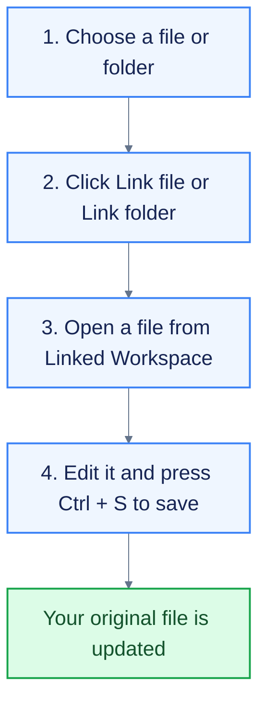

# Welcome to Linked Workspace

**Open and edit files already on your computer—right inside Markdown Viewer.** Your files stay where they are. A *link* is simply a shortcut to the original.

## 🚀 Get started

1. **Link:** In the **Explorer** sidebar, open the menu beside **Linked Workspace**.
   - Choose **Link file** to add one or more files.
   - Choose **Link folder** to add a folder and its Markdown files, including subfolders.
2. **Edit:** Click a linked file in the sidebar to open it and make changes.
3. **Save:** Press **Ctrl + S** (or **Cmd + S** on Mac) to save your changes to the original file.

## 🗺️ How it works

## 📁 File or folder?

| Choose | When to use it |
| --- | --- |
| **Link file** | Open one or more specific files. |
| **Link folder** | Browse files in a folder and its subfolders. |

## 🖱️ What do the options do?

**Right-click** a linked file or folder to open its menu.

| Option | What it does |
| --- | --- |
| **Save As** | Save a new file and link it. |
| **Remove linked file / folder** | Remove the shortcut from the sidebar; keep the original. |
| **Convert to Workspace copy** | Make a separate copy inside the app. |
| **Rescan folder** | Refresh a linked folder's file list. |
| **Reload from disk** | Open the latest saved version from your computer. |
| **Link file / Link folder** | Add links inside a linked folder to keep them organized. |

## 💡 Good to know

- **Find a file:** Hover over its name in the sidebar to see its location.
- **While editing:** The app keeps a local recovery draft. **Save** updates the original.
- **Organize:** Group links in the sidebar without moving files on your computer.
- **Close a tab:** Your link stays in Linked Workspace.

**You're ready!** Link a file or folder, open it, edit, and save.
