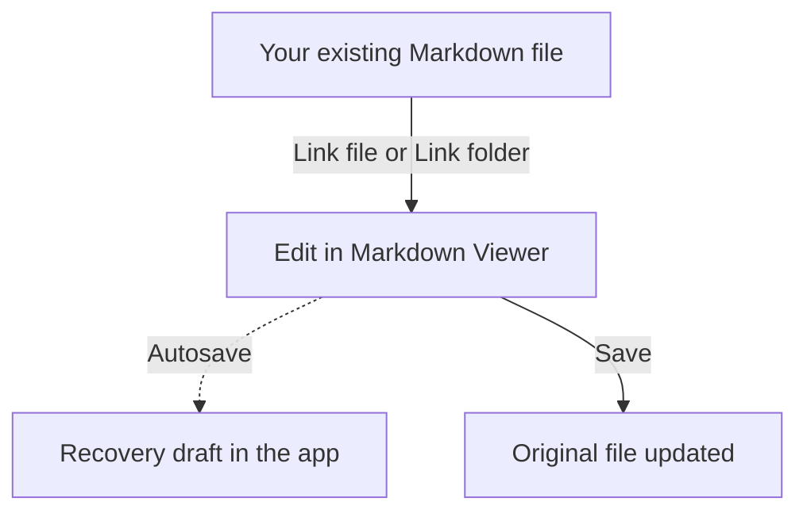

# Welcome to Linked Workspace

### Your files. Their original home.

Edit existing Markdown files without moving them into the Vault. **A link is a shortcut to an original file or folder, not a new copy.**

> [!NOTE]
> **Editing keeps a draft. Saving updates the original.** Your file stays where it is on your computer.

## How it works

The dotted arrow is automatic draft recovery. The solid **Save** arrow is your action to update the original.

---

## Get started

| Step | What to do |
| :--- | :--- |
| **1. Link** | Open the menu beside **Linked Workspace** in Explorer. Choose **Link file** or **Link folder**. |
| **2. Edit** | Click a linked file. Use Split view to write on one side and read the preview on the other. |
| **3. Save** | Press <kbd>Ctrl</kbd> + <kbd>S</kbd>, or <kbd>Cmd</kbd> + <kbd>S</kbd> on Mac, to update the original. |

**Link file** accepts one or more Markdown files. **Link folder** includes Markdown files in its subfolders too. Hover over a linked file to see its original location.

### Link or import?

| Your goal | Choose | Where you work |
| :--- | :--- | :--- |
| Edit an existing original | **Link file / Link folder** | Linked Workspace |
| Keep a separate copy | **+ > From files** | Workspace (Vault) |
| Start something new | **+ > New document** | Workspace (Vault) |

Dragging an external file into the app also imports a separate Vault copy.

> [!TIP]
> **Organize without moving originals.** Right-click a linked folder and choose **Link file** or **Link folder**. This only groups links in the sidebar. Removing the parent link keeps separately added links available outside that group.

---

## Your everyday controls

Use a tab's close button, or open a file or folder's menu for more actions. You can also right-click a file or folder.

| Action | What happens |
| :--- | :--- |
| **Close tab** | Closes the view. Keeps the file and its link. |
| **Save As** | Creates another file and link. Leaves the previous original unchanged. |
| **Remove linked file / folder** | Removes the link from the app. Does **not** delete the original. |
| **Convert to Workspace copy** | Keeps an independent copy of your draft in the Vault. Leaves the original unchanged. |
| **Rescan folder** | Finds new files and restores removed or converted links whose originals still exist. |
| **Reload from disk** | Replaces your draft with the original file. Asks before discarding unsaved changes. |

## When something changes

Another app may edit, rename, or move an original. Hover over the warning icon for details; your local draft is kept when a conflict or unavailable source is detected.

| You want to keep... | Choose |
| :--- | :--- |
| The changed file on disk | **Reload from disk**; confirm before replacing unsaved edits. |
| Your current edits | **Save**; review the confirmation before overwriting a changed original. |
| Both versions, or work from a missing original | **Save As** to create a separate file. |

> [!WARNING]
> **Keep backups of important originals.** Workspace backups keep recovery drafts, not every external file. Restoring a backup does not automatically reconnect originals.

---

<strong>More about folders, copies, and recovery</strong>

- **Folder copies:** Convert a linked folder or drag it into the Vault to copy its current drafts and subfolders. Previously removed links are not included. Converting the whole folder removes its link; converting a subfolder keeps the parent linked. Reopening an original never replaces its independent Vault copy.
- **Export a Vault folder:** **Save As linked folder...** creates a new external folder and link. The Vault copy stays unchanged. Existing destination names get a copy suffix. Only Markdown documents are exported, not images or other assets.
- **Interrupted operations:** Folder copies and exports are not all-or-nothing. A partial completion message means some files were copied; completed copies and remaining drafts are kept. Read the destination in the message before retrying.
- **Removed links:** Background refreshes respect removals, even when linked folders overlap. **Rescan folder** or linking the same folder again can restore those links.
- **Recovery:** The app stores recovery drafts separately from originals. Do not reorganize this internal storage manually. Restoring a backup recovers drafts without reconnecting their original paths. Link the originals explicitly to reconnect.
- **Secret Workspace:** Convert a linked file to a Vault copy before moving that copy into Secret Workspace.

*This is an editable guide inside the app, not an external file. Make it your own or delete it; your originals are unaffected.*
