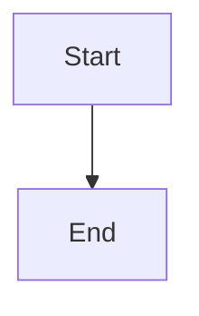
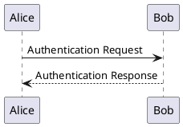
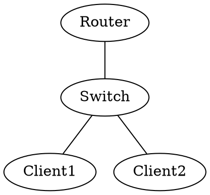

```d2
grid-demo: {
  grid-columns: 2
  box-1: Box 1
  box-2: Box 2
}
```
```markmap
# Development
## Languages
- `JavaScript`
- `Python`
## Functions
- `main()`
- `helper_func()`
```
```vega-lite
{
  "$schema": "https://vega.github.io/schema/vega-lite/v5.json",
  "data": {
    "values": [
      {"x": "A", "y": 10, "group": "one"},
      {"x": "A", "y": 15, "group": "two"},
      {"x": "B", "y": 20, "group": "one"},
      {"x": "B", "y": 5, "group": "two"}
    ]
  },
  "mark": "bar",
  "encoding": {
    "x": {"field": "x", "type": "nominal"},
    "y": {"field": "y", "type": "quantitative"},
    "color": {"field": "group", "type": "nominal"}
  }
}
```
```wavedrom
{ signal: [
  { name: "clk",    wave: "p......" },
  { name: "signal", wave: "0.h.l.h.0" }
]}
```
```stl
solid twisted_octagonal_column
  facet normal 0 0 -1
    outer loop
      vertex 0 0 0
      vertex 6.364 6.364 0
      vertex 9 0 0
    endloop
  endfacet
  facet normal 0 0 1
    outer loop
      vertex 0 0 28
      vertex 5.6631 4.1145 28
      vertex 1.095 6.9138 28
    endloop
  endfacet
  facet normal 0 0 0
    outer loop
      vertex 9 0 0
      vertex 6.364 6.364 0
      vertex 1.095 6.9138 28
    endloop
  endfacet
  facet normal 0 0 0
    outer loop
      vertex 9 0 0
      vertex 1.095 6.9138 28
      vertex 5.6631 4.1145 28
    endloop
  endfacet
  facet normal 0 0 -1
    outer loop
      vertex 0 0 0
      vertex 0 9 0
      vertex 6.364 6.364 0
    endloop
  endfacet
  facet normal 0 0 1
    outer loop
      vertex 0 0 28
      vertex 1.095 6.9138 28
      vertex -4.1145 5.6631 28
    endloop
  endfacet
  facet normal 0 0 0
    outer loop
      vertex 6.364 6.364 0
      vertex 0 9 0
      vertex -4.1145 5.6631 28
    endloop
  endfacet
  facet normal 0 0 0
    outer loop
      vertex 6.364 6.364 0
      vertex -4.1145 5.6631 28
      vertex 1.095 6.9138 28
    endloop
  endfacet
  facet normal 0 0 -1
    outer loop
      vertex 0 0 0
      vertex -6.364 6.364 0
      vertex 0 9 0
    endloop
  endfacet
  facet normal 0 0 1
    outer loop
      vertex 0 0 28
      vertex -4.1145 5.6631 28
      vertex -6.9138 1.095 28
    endloop
  endfacet
  facet normal 0 0 0
    outer loop
      vertex 0 9 0
      vertex -6.364 6.364 0
      vertex -6.9138 1.095 28
    endloop
  endfacet
  facet normal 0 0 0
    outer loop
      vertex 0 9 0
      vertex -6.9138 1.095 28
      vertex -4.1145 5.6631 28
    endloop
  endfacet
  facet normal 0 0 -1
    outer loop
      vertex 0 0 0
      vertex -9 0 0
      vertex -6.364 6.364 0
    endloop
  endfacet
  facet normal 0 0 1
    outer loop
      vertex 0 0 28
      vertex -6.9138 1.095 28
      vertex -5.6631 -4.1145 28
    endloop
  endfacet
  facet normal 0 0 0
    outer loop
      vertex -6.364 6.364 0
      vertex -9 0 0
      vertex -5.6631 -4.1145 28
    endloop
  endfacet
  facet normal 0 0 0
    outer loop
      vertex -6.364 6.364 0
      vertex -5.6631 -4.1145 28
      vertex -6.9138 1.095 28
    endloop
  endfacet
  facet normal 0 0 -1
    outer loop
      vertex 0 0 0
      vertex -6.364 -6.364 0
      vertex -9 0 0
    endloop
  endfacet
  facet normal 0 0 1
    outer loop
      vertex 0 0 28
      vertex -5.6631 -4.1145 28
      vertex -1.095 -6.9138 28
    endloop
  endfacet
  facet normal 0 0 0
    outer loop
      vertex -9 0 0
      vertex -6.364 -6.364 0
      vertex -1.095 -6.9138 28
    endloop
  endfacet
  facet normal 0 0 0
    outer loop
      vertex -9 0 0
      vertex -1.095 -6.9138 28
      vertex -5.6631 -4.1145 28
    endloop
  endfacet
  facet normal 0 0 -1
    outer loop
      vertex 0 0 0
      vertex 0 -9 0
      vertex -6.364 -6.364 0
    endloop
  endfacet
  facet normal 0 0 1
    outer loop
      vertex 0 0 28
      vertex -1.095 -6.9138 28
      vertex 4.1145 -5.6631 28
    endloop
  endfacet
  facet normal 0 0 0
    outer loop
      vertex -6.364 -6.364 0
      vertex 0 -9 0
      vertex 4.1145 -5.6631 28
    endloop
  endfacet
  facet normal 0 0 0
    outer loop
      vertex -6.364 -6.364 0
      vertex 4.1145 -5.6631 28
      vertex -1.095 -6.9138 28
    endloop
  endfacet
  facet normal 0 0 -1
    outer loop
      vertex 0 0 0
      vertex 6.364 -6.364 0
      vertex 0 -9 0
    endloop
  endfacet
  facet normal 0 0 1
    outer loop
      vertex 0 0 28
      vertex 4.1145 -5.6631 28
      vertex 6.9138 -1.095 28
    endloop
  endfacet
  facet normal 0 0 0
    outer loop
      vertex 0 -9 0
      vertex 6.364 -6.364 0
      vertex 6.9138 -1.095 28
    endloop
  endfacet
  facet normal 0 0 0
    outer loop
      vertex 0 -9 0
      vertex 6.9138 -1.095 28
      vertex 4.1145 -5.6631 28
    endloop
  endfacet
  facet normal 0 0 -1
    outer loop
      vertex 0 0 0
      vertex 9 0 0
      vertex 6.364 -6.364 0
    endloop
  endfacet
  facet normal 0 0 1
    outer loop
      vertex 0 0 28
      vertex 6.9138 -1.095 28
      vertex 5.6631 4.1145 28
    endloop
  endfacet
  facet normal 0 0 0
    outer loop
      vertex 6.364 -6.364 0
      vertex 9 0 0
      vertex 5.6631 4.1145 28
    endloop
  endfacet
  facet normal 0 0 0
    outer loop
      vertex 6.364 -6.364 0
      vertex 5.6631 4.1145 28
      vertex 6.9138 -1.095 28
    endloop
  endfacet
endsolid twisted_octagonal_column
```
```geojson
{
  "type": "FeatureCollection",
  "features": [
    {
      "type": "Feature",
      "properties": { "name": "Demo district" },
      "geometry": {
        "type": "Polygon",
        "coordinates": [[
          [-122.45, 37.76],
          [-122.41, 37.76],
          [-122.40, 37.79],
          [-122.44, 37.80],
          [-122.45, 37.76]
        ]]
      }
    },
    {
      "type": "Feature",
      "properties": { "name": "Walking route" },
      "geometry": {
        "type": "LineString",
        "coordinates": [
          [-122.45, 37.77],
          [-122.43, 37.78],
          [-122.41, 37.79]
        ]
      }
    },
    {
      "type": "Feature",
      "properties": { "name": "Meeting point" },
      "geometry": {
        "type": "Point",
        "coordinates": [-122.42, 37.785]
      }
    }
  ]
}
```

Inline math $E=mc^2$ and display math:

$$\int_0^1 x^2\,dx = \frac{1}{3}$$

```abc
X:1
T:Private score
M:4/4
L:1/4
K:C
C D E F|G A B c|
```

```topojson
{"type":"Topology","objects":{"point":{"type":"Point","coordinates":[10,20]}},"arcs":[]}
```
